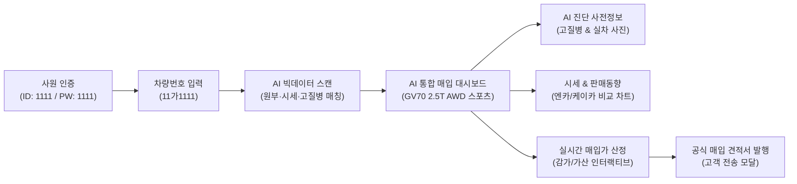

# 🚗 케이카 AI매입시스템 (K Car AI Purchase System)

> **중고차 직영 매입을 위한 AI 사전 진단 & 실시간 정밀 시세 산정 모바일 웹 플랫폼**

[](https://developer.mozilla.org/ko/docs/Web/HTML)
[](https://tailwindcss.com/)
[](https://developer.mozilla.org/ko/docs/Web/JavaScript)
[](https://www.chartjs.org/)

---

## 📌 프로젝트 소개

**케이카 AI매입시스템**은 케이카(K Car) 차량 매입사원이 현장에서 고객의 차량을 정확하고 신속하게 진단하고 최적의 매입가격을 산정할 수 있도록 지원하는 모바일 웹 솔루션입니다.

- **차량별 AI 사전 진단 정보**: 차종 고유의 고질병, 필수 점검 부위, 프리미엄 셀링 포인트 사전 학습 데이터 제공
- **멀티 플랫폼 실시간 시세 연동**: 엔카닷컴(encar.com) 및 케이카 직영몰 실시간 시세 및 30일 회전율 분석
- **실시간 인터랙티브 매입가 산정기**: 외관 판수, 타이어 마모, 휠 복원비, 가산 옵션 및 케이카 직영 마진을 반영한 실시간 견적 산출

---

## 📱 주요 화면 및 사용자 흐름



---

## 🌟 핵심 기능 요약

### 1. 사내 매입사원 인증 (Screen 1)
- 케이카 시그니처 레드 & 딥 다크 네온 글래스모피즘 룩
- 기본 테스트 계정: `사번: 1111` / `비밀번호: 1111`
- 원클릭 데모 자동 로그인 지원

### 2. 차량번호 조회 및 AI 스캐닝 (Screen 2 & Loading)
- 깔끔한 번호판 스타일의 단독 입력 인터페이스
- 테스트 차량번호: `11가1111`
- 국토부 원부 조회, 엔카/케이카 시세 수집, 고질병 DB 로딩 4단계 스캔 애니메이션 연출

### 3. AI 매입 & 진단 통합 대시보드 (Screen 3)
- **대상 차량**: 2021년식 제네시스 GV70 가솔린 2.5 터보 AWD 스포츠 패키지 (42,300km, 우유니 화이트, 1인신조)
- **[탭 1] AI 진단 사전정보**:
  - ⚠️ **고질병 & 취약 부위**: AWD 디퍼런셜 누유(~45만), 21인치 스포츠 휠 림 흠집(개당 15만), ISG 배터리/흡기호스, 파노라마 선루프 레일 이음
  - 🔍 **필수 점검 포인트 (실제 부위별 사진 포함)**: 전면 스포츠 그릴 스톤칩, 전자제어 서스펜션 댐퍼, 14.5인치 ccIC 클러스터, 스포츠 레드 나파 가죽시트
  - ✨ **장점 & 셀링 포인트**: 최고 인기 '우유니 화이트 + 세비야 레드' 내외장(+50만 시세 방어), 파퓰러2+렉시콘 풀옵션, 제조사 보증 잔여
- **[탭 2] 시세 & 판매동향**:
  - 엔카닷컴 실시간 동급 평균 시세 (`4,380만원`)
  - 케이카 직영몰 실시간 시세 (`4,390만원`)
  - 최근 30일 평균 재고 회전일수 `14.2일` (시장 평균 32일 대비 초고속 S+ 등급)
  - 최근 6개월 시세 변동 추이 차트 (Chart.js)
- **[탭 3] 실시간 매입가격 산정기**:
  - 기준 예상판매가 실시간 슬라이더 (4,100만 ~ 4,600만원)
  - 마이너스 감가: 외관 판수(판당 12만), 21인치 타이어 교체(짝당 18만), 휠 복원비, 경정비
  - 플러스 가산: 인기 색상(+50만), 핵심 옵션(+50만), 1인 신조(+30만)
  - 케이카 표준 마진: 기본 120만원 (90~180만원 조절 가능)
  - 실시간 AI 추천 매입가 및 협상 범위 즉시 산출
- **[모달] 고객 제안용 공식 매입 견적서**:
  - 현장 브리핑용 인증 카드 및 고객 카카오톡 알림톡 전송 시뮬레이션

---

## 📁 프로젝트 구조

```text
kcar-ai-purchase/
├── index.html       # 메인 애플리케이션 (SPA 모바일 뷰, Tailwind, Lucide, Chart.js)
├── styles.css       # 케이카 레드 테마, 글래스모피즘, 네온 애니메이션 스타일
├── app.js           # 인증, 스캐닝 애니메이션, 탭 전환, 실시간 계산 및 차트 로직
├── .gitignore       # Git 제외 설정 파일
└── README.md        # 프로젝트 문서 (본 파일)
```

---

## 🚀 실행 및 깃허브(GitHub) 업로드 가이드

### 1. 로컬에서 바로 실행하기
별도의 서버 설치 없이 웹 브라우저(Chrome, Edge, Safari 등)에서 `index.html` 파일을 더블 클릭하여 바로 실행할 수 있습니다.
> **Tip**: 브라우저에서 `F12`를 누른 후 **모바일 디바이스 툴바(Ctrl+Shift+M)**를 켜시면 스마트폰 화면 비율로 최적화된 UI를 확인하실 수 있습니다.

---

### 2. 깃허브(GitHub)에 업로드하는 2가지 방법

#### 방법 A: GitHub 웹사이트에서 직접 업로드 (가장 간편한 방법)
1. **[buythecar 저장소 파일 업로드 페이지](https://github.com/JisuKim-pokju82/buythecar/upload/main)**로 접속합니다.
2. `kcar-ai-purchase` 폴더 내의 파일들(`index.html`, `styles.css`, `app.js`, `README.md`, `.gitignore`)을 드래그 앤 드롭합니다.
3. 하단의 **[Commit changes]** 버튼을 누르면 업로드가 완료됩니다!

#### 방법 B: Git CLI 명령어로 푸시하기
```bash
# 1. 프로젝트 폴더로 이동
cd C:\Users\KCAR24N20051\.gemini\antigravity\scratch\kcar-ai-purchase

# 2. 깃 초기화 및 커밋
git init
git add .
git commit -m "feat: 케이카 AI매입시스템 모바일 웹 초기 구축"

# 3. 브랜치명을 main으로 설정
git branch -M main

# 4. 저장소 연결
git remote add origin https://github.com/JisuKim-pokju82/buythecar.git

# 5. 원격 저장소로 푸시
git push -u origin main
```

---

### 3. GitHub Pages로 웹페이지 바로 열기 (무료 배포)
1. **[buythecar Pages 설정 페이지](https://github.com/JisuKim-pokju82/buythecar/settings/pages)**로 접속합니다.
2. **Branch** 설정을 `main` / `/(root)` 로 선택 후 **[Save]**를 클릭합니다.
3. 약 1분 후 아래 링크를 통해 스마트폰/PC 어디서나 바로 접속할 수 있습니다:
   👉 **[https://jisukim-pokju82.github.io/buythecar/](https://jisukim-pokju82.github.io/buythecar/)**

---

## 📄 라이선스
본 프로젝트는 케이카(K Car) 사내 매입 시스템 프로토타입 샘플입니다.
